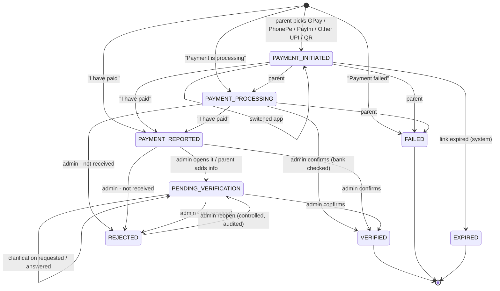
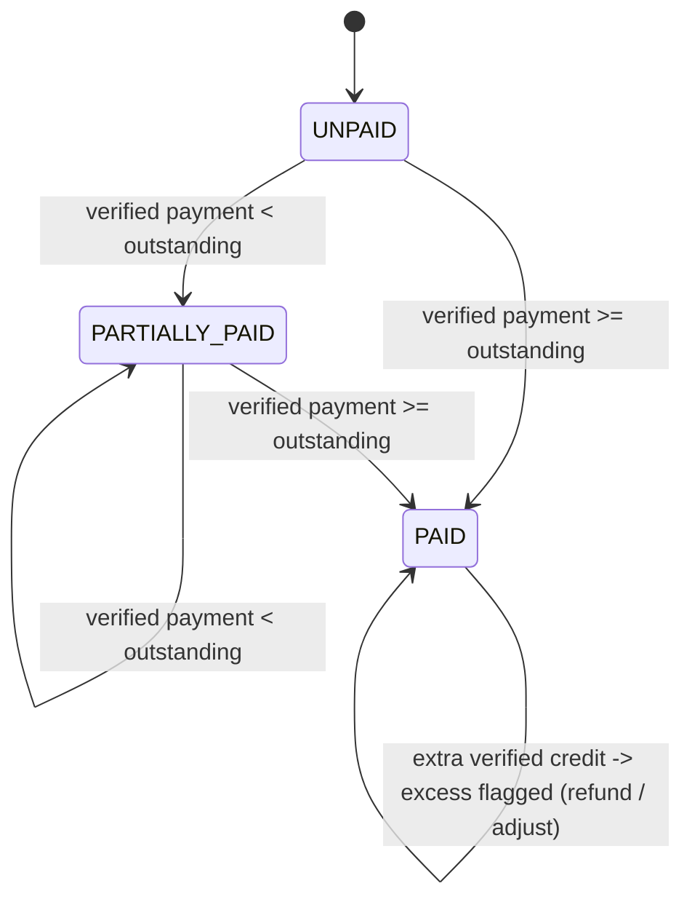

# Payment state diagrams

FeeFlow keeps **two separate state machines**. A declaration is what a parent *said*;
an installment balance changes **only** through verified payment transactions.

## 1. Payment declaration (`payment_declarations.declaration_status`)

* **Active** = `PAYMENT_INITIATED | PAYMENT_PROCESSING | PAYMENT_REPORTED | PENDING_VERIFICATION`.
  A partial unique index allows **one active declaration per installment**.
* Once `PAYMENT_REPORTED`, the parent cannot change the declaration. Another "I have paid"
  tap returns the existing one (`duplicate: true`), and other actions get `409`.
* After `REJECTED` / `FAILED` / `EXPIRED`, a new declaration can be created.
* Only the authenticated admin API can move a declaration to `VERIFIED`. The change is audited.
* Transition tables live in [`app/states.py`](../app/states.py) and are exhaustively tested
  in `tests/test_state_engine.py`.

## 2. Installment balance (`installments.status`)

`paid_paise` never exceeds `total_paise`. Any surplus goes to `excess_paise` and a
`payment_adjustments` row with status `FLAGGED`.

## 3. Display status (parent page and APIs)

Computed, never stored (`app/states.py::display_status`):

1. Installment `PAID` → **PAID**
2. Active declaration exists → its status (`PAYMENT_REPORTED`, `PENDING_VERIFICATION`, ...)
3. Link expired → **EXPIRED**
4. Latest declaration `REJECTED` / `FAILED` → that status
5. Installment `PARTIALLY_PAID` → **PARTIALLY_PAID**
6. Otherwise **UNPAID**
