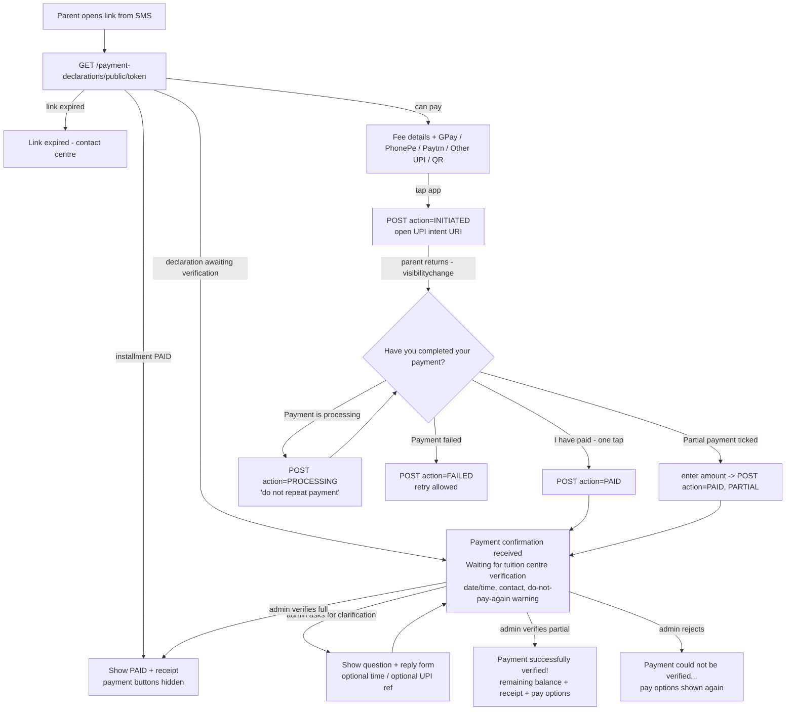

# UI flows

## Parent payment page – `/pay/{secure_token}` (mobile-first)



Notes:
* Returning from the UPI app is **not** treated as proof of payment. It only shows the question.
* The idempotency key is kept per attempt in `sessionStorage`, so repeated taps or network retries
  reuse it. Refreshing re-reads server state.
* No UTR, screenshot or amount is required for a full payment. The UPI reference is offered only
  as an optional field when the centre asks for clarification.
* Notes containing "UPI PIN", "OTP", "password" and similar are rejected by the API.

## Admin – `/admin` → **Payment Verification**

```mermaid
flowchart LR
    Q[Queue: PROCESSING / REPORTED / PENDING_VERIFICATION] --> D[Detail: student, ID, parent mobile,<br/>installment, expected vs declared amount,<br/>declared time, UPI app, history, outstanding,<br/>bank-statement match suggestions]
    D --> C[Confirm payment received]
    D --> R[Payment not received]
    D --> K[Request clarification]
    C --> C1[tick: checked bank txn + credited to centre account<br/>enter amount(s) + UTR or evidence note<br/>acknowledge amount difference if any<br/>browser confirm dialog]
    C1 --> C2[verified_payments + balance + receipt + SMS + reminders cancelled/rebased + audit]
    R --> R1[reason required -> REJECTED, SMS, reminders restored without immediate resend]
    K --> K1[question -> SMS with fresh link -> parent replies]
```

Other tabs: **Fees** (status, reminder sync state, new link, record an extra bank credit),
**Reports** (8 reports, with reopen for rejected items and resolve for excess payments),
**Notifications**, **Audit log**.
